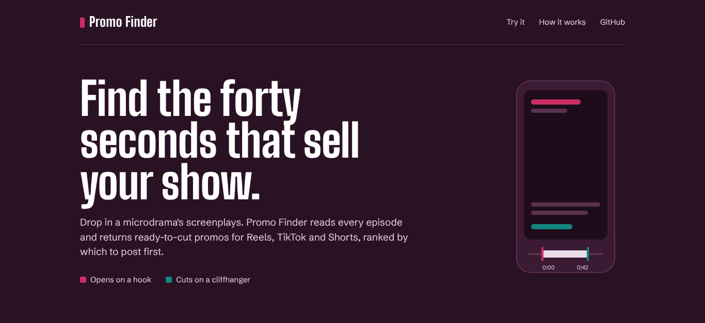
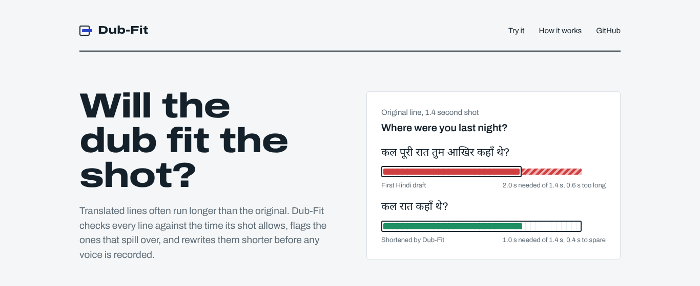

# Kuku FM: AI Generalist Assignment

**Sanidhya Jindal** · 123MM0666 · Metallurgical & Materials Engineering, NIT Rourkela

Three small, working AI tools for the three problems in Kuku's AI Generalist brief. Each one runs for free without an API key, and each has an AI mode where the model can be swapped with one setting.

| | Problem | Live app | What it does |
|---|---|---|---|
| 1 | **Find the Promos** | [kuku-promo-finder-xyz.streamlit.app](https://kuku-promo-finder-xyz.streamlit.app/) | Reads a microdrama's screenplays and returns ranked 20–60 second promo cuts, each with a hook, a cliffhanger and exact timestamps. |
| 2 | **AI Lawyer (Haq Saathi)** | Run locally: `streamlit run p2_ai_lawyer/app.py` | Legal help for everyday problems in India, by text or voice, in any language. It builds the case, explains the options, drafts the notice, and only states checked facts. |
| 3 | **Dub-Fit** (own problem) | [kuku-dubfit.streamlit.app](https://kuku-dubfit.streamlit.app/) | Checks whether each translated line fits the time slot of its shot, and shortens the ones that don't before any voice is recorded. |

---

## 1. Promo Finder



**The problem:** an editor watches every episode to pick promos by hand, and Kuku releases new shows every week.

**How it works**
1. **Read** (code): each script becomes timed lines of dialogue, action, camera and sound.
2. **Find**:
   - *Free mode* scores every legal start and end point on three things: the first 3 seconds (the hook), the final moment (the cliffhanger), and whether a new viewer can follow.
   - *AI mode* reads 3 episodes at a time and proposes promos.
3. **Check** (code): the AI answers with **line IDs, never timestamps**. Code converts them to times and rejects unknown IDs, reversed ranges and anything outside 20–60 s, so the model can't invent a cut. The rules then re-score every AI pick and flag disagreements.
4. **Rank**: strongest first, leaning toward early episodes so new viewers aren't spoiled.

**Results on the 50-episode input pack (free mode):**
- 100 promos found in under a second, all between 21 and 60 s, covering every episode.
- In a hand review of the top 10, 3 were ready to post, 3 were maybe, and 4 were no.
- Main known failure: it treats every episode ending as a cliffhanger, even happy ones.

[Folder and run steps](p1_promo_finder)

## 2. Haq Saathi: AI lawyer

**Covers:** security deposit not returned, refund or defective product, unpaid salary, cheque bounce, and UPI fraud. Anything else gets an honest "not covered" answer plus the free legal aid line, 15100.

**How it avoids made-up law**
- **Checked facts only:** it can only state 22 facts, each checked against a public source.
- **Every claim is tagged** with the fact it comes from.
- **A code check deletes any sentence** that names an Act, Section, court ruling or case that isn't in that list.
- **Notices come from fixed templates.** Missing details are left as blanks for you to fill in.
- **Some situations always go to a real lawyer:** police, court papers, or the user being the accused.

**Test results:**
- The code check removed 6 out of 6 made-up laws in its test, including Hindi *dhara*.
- It missed one wrong number with no law named. This gap is shown on purpose in `tests/test_guard.py`.
- On 12 test cases (English, Hinglish, Hindi, Odia, plus trick and out-of-scope questions), free mode got the topic right in 11 and sent every risky case to a lawyer.

[Folder, test cases and raw outputs](p2_ai_lawyer)

## 3. Dub-Fit



**The problem:** when a show is adapted into Hindi, Tamil or another language, the translated line often runs longer than the shot. The voice keeps going after the mouth stops, or the speech gets sped up and sounds robotic.

**How it works**
1. **Measure** (code): the time slot for each line comes from the script.
2. **Set the pace limit** (code): the fastest comfortable pace is taken from the fastest 10% of the show's own original lines. No outside numbers are needed.
3. **Translate** (AI), then **check** in code: syllables ÷ slot shows which lines spill over.
4. **Shorten** (AI) with an exact syllable budget, then **re-check in code**. The model never marks its own work.
5. **Review** (human): the editor checks only the flagged lines.

**Results:**
- Across all 1,487 lines in the input pack, a third have less than 30% room, so even a slightly longer translation won't fit.
- The syllable counter handles English and Indic scripts (Hindi, Bengali, Odia and others). It matched hand counts exactly on 5 of 7 test lines.

[Folder and run steps](p3_dubfit)

---

## Run it yourself

```bash
git clone https://github.com/Sanidhya-Jindal/kuku-fm-assignment
cd kuku-fm-assignment/p1_promo_finder      # or p2_ai_lawyer, p3_dubfit
pip install -r requirements.txt
streamlit run app.py
```

Each folder's README also has command-line runs and tests.

### Swap the AI model

Every tool reads the same environment variables, so a different or stronger model plugs in with no code changes:

```bash
export LLM_PROVIDER=openai                          # gemini | anthropic | openai (any OpenAI-style server)
export LLM_BASE_URL=https://api.groq.com/openai/v1  # e.g. Groq, OpenRouter, Ollama
export LLM_MODEL=<model-id>                         # copy from your provider's console
export LLM_API_KEY=<your-key>                       # never commit this
```

In the web apps, you can enter the provider, model and key on the page instead. They are used for that run only.

## Repository layout

```
p1_promo_finder/   parse.py · rules.py (free mode) · llm_mode.py (AI mode) · run.py · eval.py · app.py
p2_ai_lawyer/      kb.py (checked facts) · guard.py (law check) · lawyer.py · templates.py · app.py · tests/ · outputs/
p3_dubfit/         dubfit.py · app.py · tests/
docs/              2-page solution docs (PDF) and screenshots
```

## What's not in this repo

Kuku's input pack (the screenplays) is confidential, so it isn't here. The raw outputs for Problems 1 and 3 aren't either, because they quote the scripts; they were shared separately. To try the apps, upload your own copy of the scripts.

## AI tools used

This was built with Claude (Anthropic) for planning, code and research. Every decision, result and failure written up here was checked by running the tools on real inputs.
